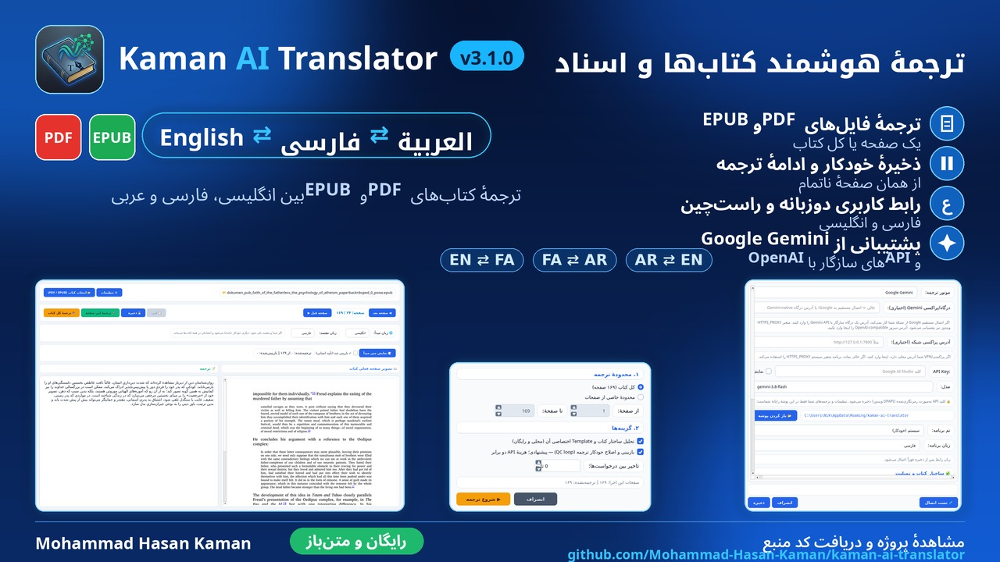
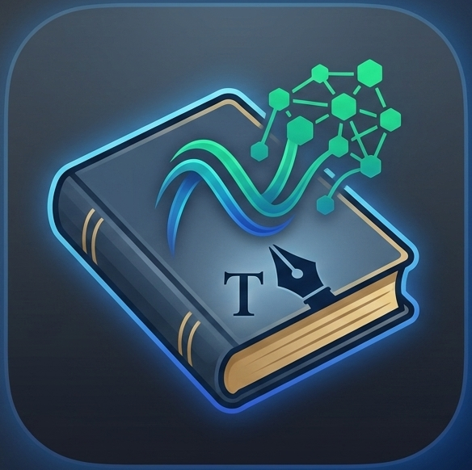

### 🌐 Telegram: [@mohaka_programmer](https://t.me/mohaka_programmer)

[](https://t.me/mohaka_programmer)
### 🔗 Website: [mhkaman.com](https://mhkaman.com) · 📖 Docs: [Project Wiki](https://github.com/Mohammad-Hasan-Kaman/kaman-ai-translator/wiki)

---

<div dir="ltr">

# Kaman AI Translator

**A Persian-first desktop studio that turns PDF & EPUB books into fluent, academic translations between English, Persian and Arabic — one page or an entire book, with a quality pipeline built for real, long documents.**

<p align="center">
  
</p>

<p align="center">
  <a href="../../releases/latest"></a>
  
  
  
  
  
</p>

---

## Table of contents

- [Why](#why)
- [Features](#features)
  - [Whole-book automation](#1-whole-book-automation)
  - [Quality engine](#2-quality-engine)
  - [Engines & providers](#3-engines--providers)
  - [Security](#4-security)
  - [Interface](#5-interface)
  - [Save & export](#6-save--export)
- [How it works](#how-it-works)
- [Privacy & data](#privacy--data)
- [Install](#install)
- [Quick start](#quick-start)
- [Settings reference](#settings-reference)
- [Building the Windows executable](#building-the-windows-executable)
- [Testing](#testing)
- [Project structure](#project-structure)
- [Roadmap](#roadmap)
- [Contributing](#contributing)
- [License](#license)

---

## Why

Translating a 300-page book with a chat window does not work: context windows are limited, quality drifts from chapter to chapter, headers get translated as content, and one crash loses everything. **Kaman AI Translator** was built around exactly those failure modes:

| Problem with naive AI translation | What this app does |
|---|---|
| The model truncates or summarizes long input | Paragraph-level smart chunking with a rolling context tail — every chunk is translated **completely** |
| Chapter headers & page numbers become translated garbage | Per-book detection of repeated headers/footers/page numbers — they never reach the model |
| The same label is translated five different ways | A per-book **structure template** (headings + recurring labels) is injected into every prompt |
| One wrong API call loses an hour of work | Every finished page is saved instantly; resume works across restarts and updates |
| You cannot pause, check, or correct anything | Pause/Resume/Cancel, a live view of the page being translated, and a per-page **“Reviewed ✓”** human approval mark |
| The key sits in the source code | In-app settings with the key encrypted by **Windows DPAPI** — never in code, never in plain text |

---

## Features

### 1. Whole-book automation

- **Batch translation** of an entire book or any page range — press once and walk away.
- **Resume vs. restart:** when saved pages exist, the dialog asks whether to continue from the first unfinished page or re-translate the whole book from scratch.
- **Pause / Resume / Cancel** with instant state save; after a quota stop, “Resume” continues from the same page.
- **Live page following:** the app displays the page currently being translated (image or extracted text) while **page navigation stays fully unlocked**; if you browse manually, auto-following steps aside.
- **Settings remain editable while paused** (and after a quota stop) — a new key, model or endpoint applies from the very next page.
- Optional **request delay** between calls for rate-limited providers.
- **Scanned pages** are not skipped: they are translated through image-based OCR.

### 2. Quality engine

- **Smart chunking** splits at paragraph boundaries (never mid-sentence) with a configurable character budget.
- **Rolling context tail:** each chunk carries the end of the previous translation, so terminology and flow stay consistent across a whole chapter.
- **Book-specific structure template:**
  - font hierarchy, chapter headings and **recurring section labels** (“Did you know?”, “Activities”, …) are detected **per book** (free, local analysis),
  - injected into every prompt so each label is translated **the same way on every page**,
  - editable manually in *Settings → Template editor*,
  - optional **AI deep pass** (one extra request that reads the table of contents).
- **High-accuracy reading:**
  - repeated running headers / page numbers are excluded from the model input,
  - hyphen-broken words are rejoined (`exam-` + `ple` → `example`),
  - list numbers and mid-text formulas are protected.
- **Completeness-enforcing prompts:** no omissions, no summaries; paragraph structure, numbers, equations and citation markers (`[12]`) are preserved; one consistent term per concept.
- **Automatic QC review loop** (optional): each translation is compared against the source; meaning drift and omissions are flagged and corrected (doubles API usage).
- **JSON-safety:** raw-JSON model replies are detected, unwrapped and cleaned — you never see JSON garbage in the output.
- **Three languages, every direction:** English, Persian and Arabic in any pairing, with a dedicated language bar; the direction is remembered across sessions.

### 3. Engines & providers

- **Google Gemini** (official SDK), or **any OpenAI-compatible endpoint** — Ollama / LM Studio / llama.cpp locally, or cloud aggregators.
- **Per-engine memory:** each engine keeps its own base URL, API key and model — switching engines never leaks one engine's values into the other, and switching back restores yours.
- Built-in **Test connection** with a clear success/failure report; for OpenAI-compatible servers it also verifies structured (JSON) output and warns about small local context windows.
- Automatic **retry** on transient failures and quota detection with a safe pause.

> **A note on output quality.** This app sends your text to the provider and model **you** configure, and returns what that model produces. Translation quality, completeness and accuracy therefore depend on the provider and model you choose, on their current load, and on your plan's limits: an overloaded, rate-limited or entry-level model can produce weaker, incomplete or occasionally incorrect output, and when the selected model is unavailable a fallback model may answer in its place - the **Test connection** report tells you which model actually responded. If a translation looks off, check the provider and model first, or switch to a stronger model, and always review important translations before relying on them. This is a property of the AI service you connect to, not of the app itself.

### Local servers (Ollama / LM Studio)

The translator also works fully offline against a local OpenAI-compatible server. Start the server first, then use these values in **Settings**:

| Setting | Ollama | LM Studio |
|---|---|---|
| Engine | OpenAI-compatible | OpenAI-compatible |
| Base URL | `http://localhost:11434/v1` | `http://localhost:1234/v1` |
| API Key | `ollama` (placeholder) | `lm-studio` (placeholder) |
| Model | A model you pulled, e.g. `llama3.1`; leave blank to discover the first model advertised by the server | The loaded model's id; leave blank to discover the first model advertised by the server |

- **LM Studio:** load a model, then start the server from the **Developer** tab before connecting.
- **The API key is a placeholder for these two servers.** By default, Ollama and LM Studio do not authenticate local requests, so the key is never checked — it only has to be non-empty, because the OpenAI client requires one.
- **This is not universal.** Some local servers and gateways enforce their own API key when authentication is enabled on them (for example 9Router, or vLLM started with `--api-key`). With those, enter the real key the server issued instead of a placeholder.
- **Raise the context window (Ollama).** Ollama allocates a small context by default (4,096 tokens on machines with less than 24 GiB of VRAM), and long prompts are truncated silently — a book chunk plus its context tail easily overflows it, which surfaces as invalid-JSON translation errors. The OpenAI-compatible API has no context-size field, so raise it on the Ollama side: set `OLLAMA_CONTEXT_LENGTH=16384` before starting the server, or bake it into a custom model with a Modelfile (`FROM <model>` plus `PARAMETER num_ctx 16384`, then `ollama create <name> -f Modelfile`) and use that model name in Settings.

Press **Test connection** after entering the values; a success report means the local model is reachable and ready.

### 4. Security

- The API key is entered once, masked in the UI, and stored **encrypted with Windows DPAPI** (tied to your Windows account).
- The key never appears in the source code, in the repository, in releases, or in logs.
- No telemetry, no update-checkers, no background network activity beyond the provider **you** configured.

### 5. Interface

- **Bilingual UI (Persian / English)** with automatic RTL/LTR layout — every dialog, menu and alignment follows the chosen language.
- Themes: **System / Dark / Light**.
- Clear control states: the **Copy** button is blue when the page is ready and gray otherwise; every action carries a tooltip explaining when to use it.
- Progress percentage follows RTL (fills from the right, number on the right).
- Live statistics: translated pages vs. reviewed pages of the current book.

### 6. Save & export

- Per-page auto-save to a per-file job store (resume-safe across restarts and app updates).
- Export the current page as **TXT**, the whole book as **Markdown**, or a complete **HTML book with page images** (direction follows the target language) — open it in any browser and use *Print → Save as PDF* for a finished PDF.
- Per-page **“Reviewed ✓”** human-approval checkbox that feeds the statistics and your final quality check.

---

## How it works

```
PDF / EPUB page
   │  extraction — reading order, de-hyphenation, header/footer removal
   ▼
smart chunking (paragraph boundaries, configurable budget)
   │  per chunk: prompt = source text
   │             + rolling context tail      (consistency)
   │             + book structure template   (headings & recurring labels)
   │             + completeness rules        (never omit / never summarize)
   ▼
provider (Gemini or any OpenAI-compatible server)
   │  JSON-safe parsing with raw-JSON fallback
   ▼
optional QC pass — translation compared against the source & corrected
   │
   ▼
per-page save (resume-safe job store)  →  TXT / Markdown / HTML export
```

The UI runs on `QThread` workers — translation, structure analysis and exports never freeze the window.

---

## Privacy & data

- Everything lives **only on your PC**, under `%APPDATA%\kaman-ai-translator\`:
  - `config.json` — settings + the API key **encrypted with Windows DPAPI**,
  - `jobs\<hash>.json` — your translations and review marks, one file per book (keyed by the file path),
  - `encrypt_fallback.log` — only written if DPAPI is ever unavailable: timestamp plus the error message, **never any secret** (the key then falls back to clearly-labelled base64 storage so the app keeps working).
- The in-app **Settings** dialog shows this exact folder (copyable) and has an **“open folder” button**, so nothing is ever hidden from you.
- The only network traffic is from your computer **to the provider you configured**.
- Nothing personal is embedded in the source code, the releases or the executable — verified before every release.

---

## Install

### Option A — Windows executable (recommended)

Download `kaman-ai-translator-3.1.0.exe` from the [latest release](../../releases/latest) and run it. No Python required.

### Option B — Run from source

```bash
git clone https://github.com/Mohammad-Hasan-Kaman/kaman-ai-translator.git
cd kaman-ai-translator
pip install -r requirements.txt
python translator_app_v3.py
```

---

## Quick start

1. **⚙️ Settings** → pick the engine (Gemini or OpenAI-compatible), paste your API key, optionally set the model name (blank uses Gemini's default or discovers a server model), then press **Test connection**.
2. **📂 Open book (PDF / EPUB)** → open your book.
3. **Single page:** *Translate this page* · **Whole book:** *Translate the whole book* and in the dialog:
   - choose the page range,
   - keep *analyze book structure* on (free & local),
   - enable the *QC review loop* for maximum quality (double API cost),
   - set a delay if your provider rate-limits,
   - decide **continue** or **re-translate from scratch** when saved pages exist.
4. While it runs: **⏸ Pause** pauses (Settings becomes editable), **■ Cancel** cancels safely, and the current page follows along automatically.
5. When a page finishes: read it → tick **✓ Reviewed** if approved → **📋 Copy** or export the whole book.

### Getting a Gemini API key

The Gemini engine needs a free Google AI Studio key - no card required:

1. Open [aistudio.google.com](https://aistudio.google.com) and sign in with a Google account.
2. Choose **Get API key** -> **Create API key**, and copy the key.
3. In the app: **Settings -> Gemini**, paste the key, keep the default model (or set your own), and press **Test connection**.

Google AI Studio is available only in supported regions. If the page does not open or reports that the service is unavailable in your region, connect from a supported region first - the app needs the same route every time it calls the Gemini API.

---

## Settings reference

| Setting | Description |
|---|---|
| Engine | Google Gemini, or any OpenAI-compatible server (local or cloud). |
| Base URL | OpenAI-compatible endpoint, or an optional Gemini-native API gateway URL for Gemini. |
| Gemini proxy | Optional HTTP(S) network proxy for Gemini (for example `http://127.0.0.1:7890`). If blank, the SDK uses the system `HTTPS_PROXY` setting. |
| Model | Model name, e.g. `gemini-3.8-flash` or a local model id. Leave blank for Gemini's default or automatic discovery from an OpenAI-compatible server. |
| API Key | Stored encrypted with Windows DPAPI; masked in the UI. |
| App language | Persian or English; interface text and RTL/LTR layout update immediately after saving. |
| Theme | System / Dark / Light. |
| Auto-analyze structure on file open | Free, fully local detection of headings & recurring labels of the opened book. |
| AI deep structure pass | One extra API request that reads the table of contents and extracts headings, labels and a summary. |

A fresh installation defaults to Persian and follows the Windows system theme.
When Qt cannot report the Windows color scheme, the app checks the Windows
app-theme setting and then falls back to the system palette.

Saved translations are kept separately for each source/target language pair.
Older job files without direction metadata are preserved, then translated again
under the selected direction so an Arabic page cannot appear in a Persian book.
| Show Template editor | Two text areas (headings / recurring labels — one item per line) saved **per open book**; steers term consistency in every prompt. |
| Chunk size / context tail | Advanced parameters of the translation pipeline. |
| Request delay | Pause between API calls (0–30 s). |

---

## Building the Windows executable

```powershell
pip install -r requirements.txt pyinstaller
pyinstaller --noconfirm --clean --onefile --windowed `
  --icon icon.ico `
  --add-data "icon.png;." `
  --collect-data google.genai `
  --collect-all pydantic --collect-all pydantic_core `
  --name kaman-ai-translator-3.1.0 `
  translator_app_v3.py
```

> - `--add-data "icon.png;."` bundles the app icon **inside** the executable — without it the window/taskbar icon is missing in packaged builds.
> - `--collect-data google.genai` includes the Gemini SDK's data files while avoiding optional local-tokenizer dependencies.
> - `--collect-all pydantic --collect-all pydantic_core` includes Gemini's validation dependency in the executable.
> - The frozen app registers its bundled Qt DLL directory and preloads the Windows ICU DLLs before importing PyQt6, preventing unrelated Qt/ICU installations on `PATH` from breaking startup.
> - On Linux/macOS use `:` as the `--add-data` separator (e.g. `icon.png:.`).

---

## Testing

The suite is **fully offline** — fake engines, temporary profiles, no network, no API key:

```bash
python tests/test_v3.py
# expected: ALL V3 TESTS PASSED  (303 checks)
```

Covered: prompts & JSON parsing, chunking and context rolling, structure detection & template merging, header/footer removal, job store resume/restart, RTL geometry of every screen, the batch UI state machine (pause/cancel/settings-while-paused), exports, and the encrypted-config round-trip.

---

## Project structure

```
kaman-ai-translator/
├── translator_app_v3.py   # PyQt6 UI & QThread workers (entry point)
│                           #   batch engine, live view, dialogs, themes
├── kaman_core.py          # Qt-free core: config + DPAPI encryption,
│                           #   prompts, chunking, structure analysis,
│                           #   engines (Gemini / OpenAI-compatible),
│                           #   job store, exporters
├── tests/test_v3.py       # 303-check offline test-suite
├── icon.png / icon.ico
├── requirements.txt
├── LICENSE
└── CONTRIBUTING.md
```

The core is deliberately **Qt-free**, which is what makes the whole pipeline testable headlessly.

---

## Roadmap

Ideas under consideration — feedback and PRs welcome:

- [ ] Linux & macOS support (the core is already portable; DPAPI needs a keyring backend)
- [ ] Glossary export/import (term consistency across several books)
- [ ] Side-by-side source/target view during batch runs
- [ ] Direct PDF output (embedded RTL font rendering)
- [ ] Per-chapter progress history and throughput statistics

---

## Contributing

Issues, bug reports and pull requests are welcome — please read [CONTRIBUTING.md](CONTRIBUTING.md) first (it covers the offline test requirement, the RTL conventions and the security rules).

## License

Distributed under the [MIT License](LICENSE).
Free to use, modify and share — even commercially.

---

---

### ⭐ Thanks for the star

If this tool is useful to you, please give it a star — the biggest support for continued development of the project.
